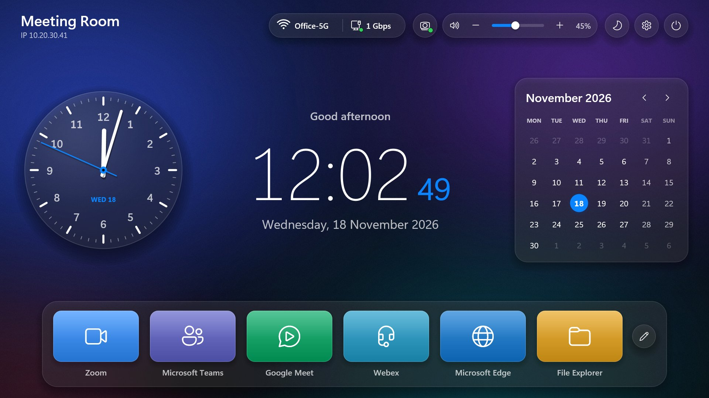
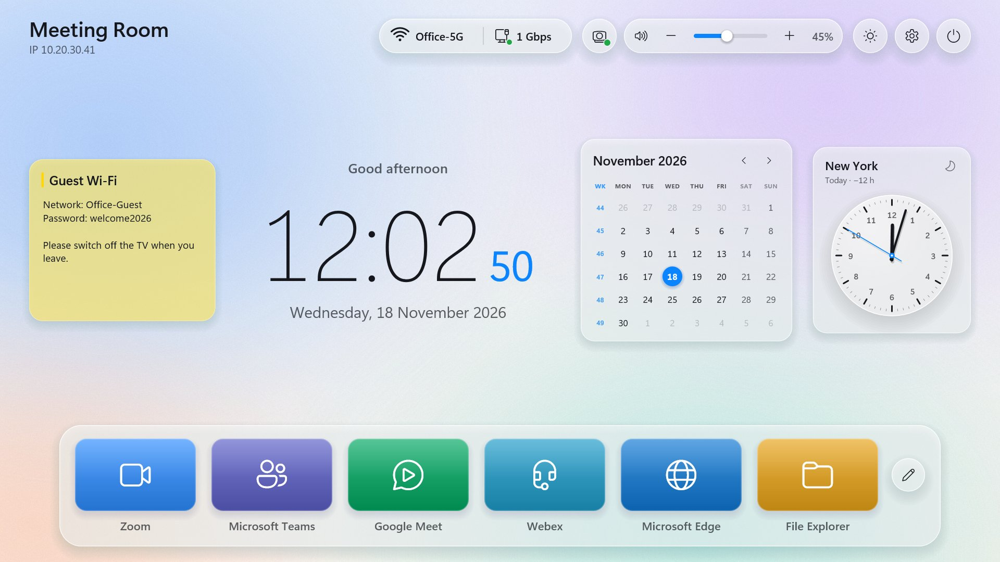
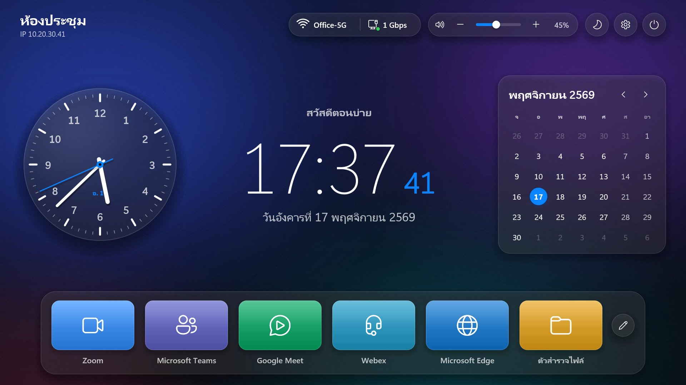
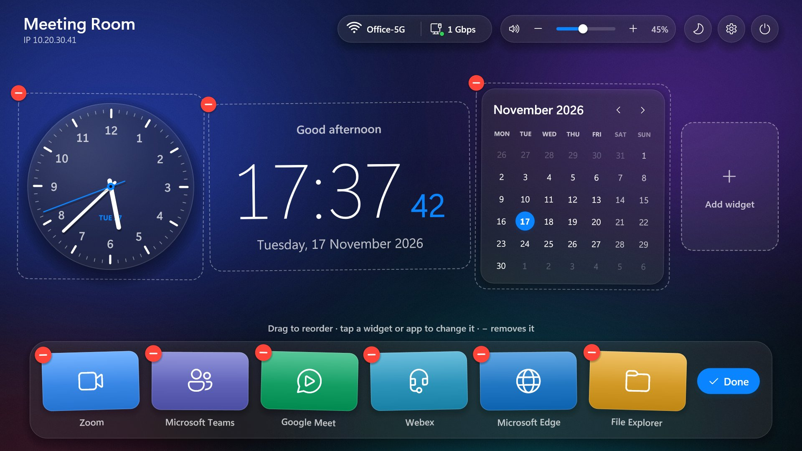
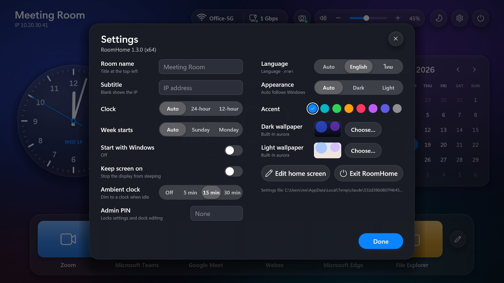
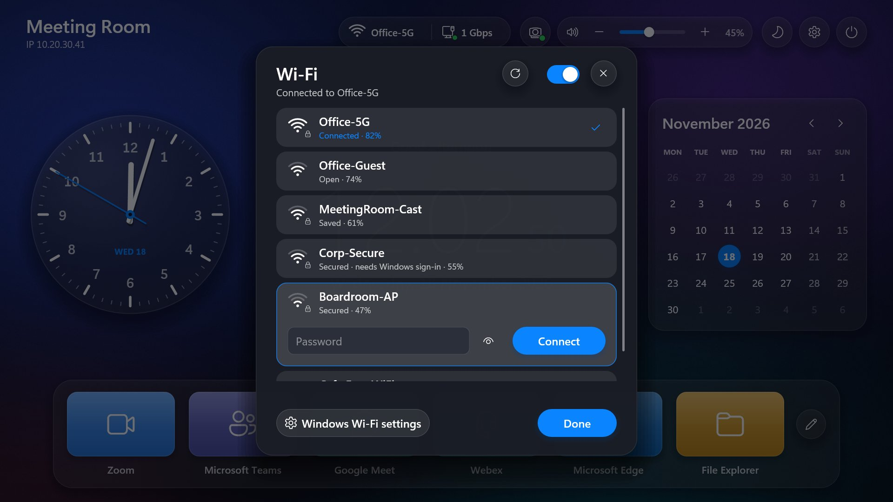

# RoomHome

A full-screen home screen for meeting-room PCs running Windows 11. It shows the time, date and calendar,
and gives people one-tap buttons for Zoom, Microsoft Teams and Google Meet, plus Wi-Fi, network, volume
and power controls. Meeting apps open on top of it; when they close, RoomHome is back.

English and Thai (ภาษาไทย) · x64, x86 (32-bit) and ARM64 · one small .exe, nothing else to install



## Features

- **Clocks and calendar**: an analog clock, a large digital clock with seconds and a month calendar.
  World clocks can show any Windows time zone.
- **Widgets**: up to 4 on the home screen. Choose from analog clock, digital clock, calendar (optional ISO
  week numbers), world clock, note, and photo. A photo widget shows one picture or a folder as a slideshow.
  Each widget has its own options and a live preview while you edit it.
- **App dock**: up to 6 apps (3 to 8 with a setting). Zoom, Microsoft Teams and Webex open their desktop
  app, or their web version when the app isn't installed. Google Meet opens
  meet.google.com in Edge. Also available: Edge, Chrome, File Explorer, Cast screen (Win+K), Display mode
  (Win+P), PowerPoint, any website, and any program, shortcut, document or Store app.
- **Top bar**:
  - Wi-Fi: pick a network, type the password, connect or forget, turn Wi-Fi on and off.
  - LAN: speed, IP, gateway, DNS and MAC, with an internet status dot.
  - Volume: mute, − / +, or drag the slider.
  - Light/dark switch, Settings, and Shut down / Restart (press and hold to confirm).
- **Editing**: press and hold any widget or app, then drag to reorder, tap to edit, or remove (with Undo).
- **Settings**: language, room name and subtitle, 12/24-hour clock, first day of the week, light/dark/auto
  appearance, accent colour, separate dark and light wallpapers, Start with Windows, Keep screen on, an
  ambient clock that dims the screen when idle (protects TVs from burn-in), and an optional admin PIN that
  locks settings and editing.
- **Input**: touch, mouse, keyboard and presentation remotes (arrow keys + Enter).
- **Languages**: English and Thai, switched in Settings › Language. Thai uses Thai month and day names and
  Buddhist-era years.

## Screenshots

| Light theme with four widgets | Thai |
| --- | --- |
|  |  |
| **Editing the home screen** | **Settings** |
|  |  |
| **Wi-Fi** | |
|  | |

## Download and install

Get the latest version from [Releases](../../releases):

- **`RoomHome-<version>-setup.exe`**: one installer for every PC. It installs the right build for the
  processor (x64, x86 or ARM64) and asks for a language. It can also start RoomHome with Windows and add a
  desktop shortcut.
- **`RoomHome-<version>-<arch>.exe`**: portable copies that run without installing.

Silent install for deploying to many rooms:

```text
RoomHome-1.2.0-setup.exe /S [/LANG=en|th] [/NOAUTOSTART] [/DESKTOP] [/ARCH=x64|x86|arm64] [/D=C:\Folder]
```

| Switch | Effect |
| --- | --- |
| `/S` | Silent install |
| `/LANG=en` or `/LANG=th` | Language (a silent install otherwise uses the Windows display language) |
| `/NOAUTOSTART` | Don't start RoomHome when someone signs in |
| `/DESKTOP` | Add a desktop shortcut |
| `/ARCH=` | Force a build instead of the PC's own |
| `/D=` | Install folder (must be the last switch) |

Uninstall from Settings › Apps, or silently with `"C:\Program Files\RoomHome\Uninstall.exe" /S`.

To close RoomHome, use Settings › Exit RoomHome. Alt+F4 is ignored on purpose.

## Configuration

Settings are saved per Windows user in `%APPDATA%\RoomHome\config.json`.

To set up many rooms the same way, edit
[`RoomHome.defaults.sample.json`](RoomHome.defaults.sample.json) and save it next to `RoomHome.exe` as
`RoomHome.defaults.json`. Any user who has no settings yet starts from it. Extra keys that have no
on-screen setting: `"dockSlots"` (3 to 8), `"volumeStep"` (1 to 20 %) and `"monitor"` (0 = main display,
1 to n = a specific display).

Command line:

| Option | Effect |
| --- | --- |
| `--quit` | Close a running RoomHome (it saves first) |
| `--config <file>` | Use another settings file |
| `--lang en\|th` | Start in this language (same as choosing it in Settings) |
| `--dry-run` | Show what would be launched or powered off, without doing it |
| `--window 1280x720` | Run in a window instead of full screen |
| `--diag <file>` | Write a report of the apps, audio, Wi-Fi, LAN and internet it finds |

The full user guide is [`README.txt`](README.txt) (English) and [`README.th.txt`](README.th.txt) (ภาษาไทย).
Both are installed with the app.

## Things to know

- **Wi-Fi list is empty on Windows 11 24H2 and later?** Windows only lets desktop apps list Wi-Fi networks
  when location access is on: Settings › Privacy & security › Location › "Let desktop apps access your
  location". RoomHome shows a button that opens that page.
- Company Wi-Fi that needs a username sign-in (802.1X) must be joined from the Windows Wi-Fi list.
  RoomHome has a button for that list too.
- For a dedicated room PC, combine Start with Windows with automatic sign-in of a local account.

## Building from source

Requirements:

- Windows 10 or 11, on an x64 or ARM64 build machine.
- Visual Studio 2022 or later with the **Desktop development with C++** workload and the x64, x86 and
  ARM64 build tools.
- [NSIS 3](https://nsis.sourceforge.io/) for the installer.

```text
build.cmd             all three builds, portable copies and the installer, in dist\
build.cmd noinstall   the three builds only
build.cmd x64         one build (x64, x86 or arm64)
```

`build.cmd` finds Visual Studio with vswhere. To use a different copy, set `VCVARS` to its `vcvarsall.bat`.
To use NSIS from another folder, set `MAKENSIS`.

The code is C++20 using Win32, Direct2D and DirectWrite, and it uses only DLLs that ship with Windows. It
links the C runtime statically, so there is no Visual C++ redistributable to install.

| Folder | Contents |
| --- | --- |
| `src/` | The app |
| `installer/` | The NSIS script |
| `res/` | The icon |
| `tools/` | Test and helper scripts |

## Tests

- `tools\ui-test.ps1 -Arch x64|x86|arm64 -OutDir <folder>`: starts RoomHome off-screen with a throw-away
  settings file. It drives the real window: rename, theme switch, Start with Windows, a dry-run launch,
  adding a note widget, a photo widget and switching language. It only closes the window it started.
- `tools\installer-test.ps1 -OutDir <folder>`: builds a per-user test installer, then checks a default
  install, a reinstall with switches (`/ARCH`, `/LANG`, `/NOAUTOSTART`, `/DESKTOP`) and the uninstall.
- `RoomHome.exe --screenshot out.png --demo [--sheet settings|wifi|...] [--lang th]` renders a screen to a
  PNG file without opening a window. The screenshots above were made this way.

Both test scripts pass on all three builds. The x64 and x86 builds have also been used on other PCs,
where Wi-Fi and a real shutdown worked. Not yet tested on real hardware:

- touch and pen input
- an actual restart (the automated tests use `--dry-run`)
- building on an x64 machine (it has only been built on ARM64 so far)
